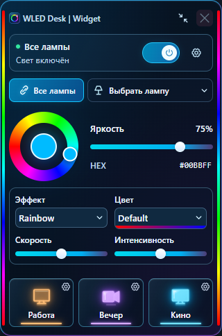
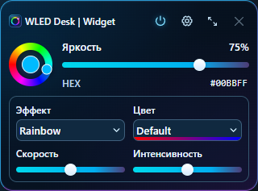

# WLED Desk | Widget

[Русский](README.md) · [Windows releases](https://github.com/rebornstudio313/wled-desk-widget/releases)

A compact Windows desktop controller for WLED on ESP32/ESP8266. **0.1.0-alpha.3**, experimental and unsigned; independent from the WLED project.

## Features

- Discover WLED devices on the LAN or add an IP/.local address manually.
- Individual lamp controls, live online/offline status, per-lamp power switches and local renaming.
- Color wheel, HEX, brightness, effects and real palette names with color previews.
- Phone/external changes reflected through WebSocket with polling fallback.
- Editable Work / Evening / Cinema scenes with per-device presets or custom settings.
- One-shot state copying to all lamps or a saved set of targets.
- Live Peek along the edges, transparent unlit pixels and bounded silent reconnection.
- Full/mini mode, tray, right-click always-on-top, free-area dragging and remembered window position.
- Live transparency adjustment in a separate compact editor.
- Global hotkeys with multiple user-defined bindings per action.
- Optional Windows login launch and start-in-tray preference; disabled by default.
- Single-instance protection; repeated launch restores the existing window.
- Version/build identity and on-demand GitHub release checks, with manual installation.

## Install

Download the installer from a published [GitHub Release](https://github.com/rebornstudio313/wled-desk-widget/releases), install for your Windows account, then add devices in Settings. If no release is published, no public download is available yet. Builds can also be obtained from the manual Windows installer workflow or built from source. Enable login launch only after installing or placing the portable EXE in a permanent location.

## Limitations

Main controls edit the first segment and RGB. RGBW/CCT, playlist and segment editors are not implemented. WLED presets apply as stored. Copying is one-shot, not continuous or frame-synchronized. Peek can be taken by another client. Palette samples are visual previews, not live animation; Random Cycle is illustrative. mDNS depends on network multicast support. There is no separate Peek window or hardware/RGB-software integration. A clean-machine Windows/DPI QA pass is still pending; login-launch registration is tested without rebooting Windows.

## Development

Node 24 and pnpm 11.25.0: `pnpm install --frozen-lockfile`, `pnpm check`, `pnpm build`, `pnpm preview`. Preview is loopback-only on port 1421. UI tests require Edge: `pnpm test:ui`. Native builds additionally require Rust MSVC, Windows SDK and C++ Build Tools: `pnpm build:native`. Build outputs and local profiles are excluded from source. Actual screenshots use isolated test fixtures, not personal device data.

[MIT](LICENSE). See [third-party notices](THIRD_PARTY_NOTICES.md) and [build status](docs/BUILD-STATUS.md).
