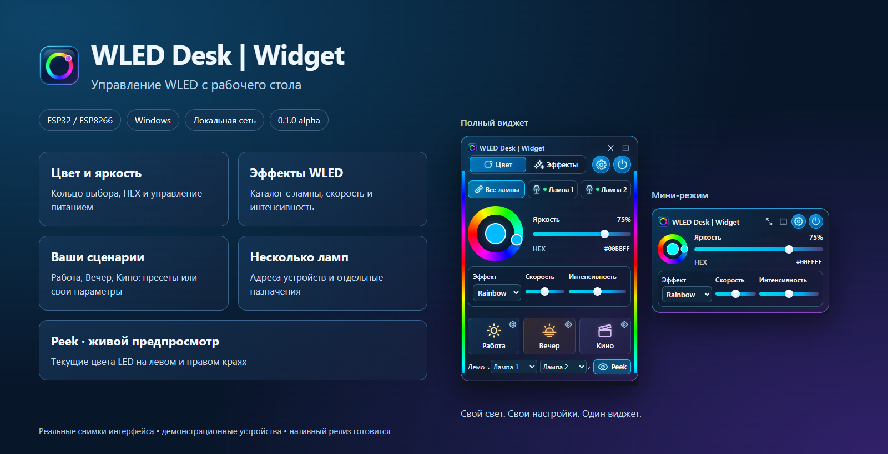

# WLED Desk | Widget



A compact Windows desktop controller for **WLED on ESP32 and ESP8266**.
Color, brightness, effects, presets, personal scenes and live LED preview over your LAN.
This is an independent project, not an official WLED application.

**Early alpha.** Check [build status](docs/BUILD-STATUS.md) before downloading an installer.
The browser preview is tested. Native Windows features must be validated separately.

## Features

- Add devices by local IP or .local hostname; restore saved devices on startup.
- Control a selected device or all devices: power, RGB/HEX, brightness, effect speed/intensity.
- Work / Evening / Cinema scenes: per-device presets or custom parameters.
- Peek strips on both edges, with independent source selection.
- Persistent compact mode with a small color wheel and essential controls.
- Local storage; no cloud account, hardware flashing or other RGB software integration.

## Run from source

```powershell
pnpm install --frozen-lockfile
pnpm build
pnpm preview
```

Requires Node.js 24 and pnpm 11.25.0. Open `http://127.0.0.1:1421`, add your own WLED
addresses in Settings. With an empty registry, the app starts in demo mode.

## Build Windows installer

Install Rust 1.99.1 MSVC, Microsoft C++ Build Tools, Windows SDK and WebView2.
Run `pnpm build:native`. Artifacts and SHA256 checksums are copied to `release-local/`.
The manual GitHub Actions Windows build uploads artifacts without publishing a Release.

## Limits

Custom scenes currently edit RGB and the first segment; palettes, RGBW/CCT and advanced
segments are future work. A saved WLED preset is applied as-is. WLED provides Peek to
only one client per device. Per-device effect IDs are resolved by name. This is not
frame-accurate hardware synchronization. Browser preview cannot hide in the system tray.

[Russian documentation](README.md) · [MIT license](LICENSE) · [Build guide](docs/BUILD-WINDOWS.md).
