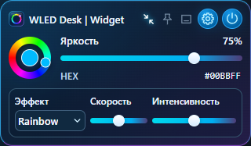

# WLED Desk | Widget

[English](README.en.md) · [Пять вариантов оформления](docs/readme-options/README.md)


**Настольный виджет для WLED на ESP32 и ESP8266.** Цвет, яркость, эффекты,
пресеты и ваши сценарии в компактном стеклянном интерфейсе. Прямое соединение
с устройствами в локальной сети, без облачного аккаунта.

**Статус: 0.1.0 alpha, подготовка первого Windows-релиза.** Рабочий браузерный
прототип проверен; готовность EXE и нативного трея смотрите в
[статусе сборки](docs/BUILD-STATUS.md). Не является официальным приложением WLED.

## Возможности

| Функция | Что делает |
|---|---|
| Несколько ламп | Добавление по локальному IP/имени, управление одной или всеми |
| Цвет и яркость | Цветовое кольцо с маркером, HEX, включение и яркость |
| Эффекты WLED | Каталог с лампы, скорость и интенсивность; общие эффекты для группы |
| Сценарии | Работа / Вечер / Кино: свои параметры или пресет отдельно для каждой лампы |
| Peek | Живые цвета LED по двум краям, независимый выбор источников |
| Мини-режим | Маленькое кольцо, HEX, яркость и параметры эффекта; выбор режима запоминается |
| Локальные данные | Адреса и сценарии хранятся на компьютере пользователя |

<p align="center">
  
  
</p>

Снимки демонстрируют интерфейс и тестовые устройства. Скрытие в трей относится
к нативной версии; браузерная версия не создаёт значок в системном трее.

## Установка

Первый установщик готовится. После публикации он будет доступен в разделе
**Releases** этого репозитория. Не скачивайте EXE из комментариев и сторонних зеркал.
Порядок проверки сборки и установки описан в [инструкции](docs/INSTALL.md).

Для запуска исходников нужны Node.js 24 и pnpm 11.25.0:

```powershell
pnpm install --frozen-lockfile
pnpm build
pnpm preview
```

Откройте `http://127.0.0.1:1421`. В настройках выберите «Мои лампы» и укажите адрес
WLED, например `192.168.1.50`. При следующем запуске сохранённые лампы загрузятся
автоматически. Если устройств ещё нет, включается демонстрационный режим.

## Совместимость и ограничения

- Windows 10/11 x64 — целевая платформа первого релиза.
- На ESP32/ESP8266 должна работать совместимая WLED. Это приложение не прошивает контроллеры.
- Устройства и компьютер должны быть доступны друг другу в локальной сети.
- WLED отдаёт Peek одному клиенту на лампу; другой Peek может перехватить поток.
- Свои параметры сценария пока управляют первым сегментом и RGB. Расширенные
  сегменты, палитры, RGBW/CCT и переходы остаются в плане; пресет применяется как есть.
- Это не аппаратная покадровая синхронизация контроллеров. Нет интеграций с ПО
  материнских плат, клавиатурами и сторонними RGB-сервисами.

## Документация

- [Установка и первые шаги](docs/INSTALL.md)
- [Сценарии и пресеты](docs/SCENES.md)
- [Peek](docs/PEEK.md)
- [Мини-режим, иконка и трей](docs/WINDOW-MODES.md)
- [Разработка и сборка EXE](docs/BUILD-WINDOWS.md)
- [Архитектура](docs/ARCHITECTURE.md) · [План работ](docs/REMAINING.md)
- [История изменений](CHANGELOG.md) · [Сообщить об ошибке](.github/ISSUE_TEMPLATE/bug_report.md)

## Разработка

```powershell
pnpm check
pnpm build
pnpm build:native
```

Для последней команды нужны Rust MSVC, C++ Build Tools, Windows SDK и WebView2.
Исходники интерфейса — `apps/desktop/src`, нативная часть — `apps/desktop/src-tauri`.
Проверки браузера находятся в `tests/integration`; для них нужны Playwright и Edge.
Профили `.local`, зависимости и результаты сборки исключены из Git.

## Лицензия и благодарности

Код проекта — [MIT](LICENSE). WLED — отдельный проект и отдельная лицензия:
[официальная документация](https://kno.wled.ge/). Сторонние компоненты перечислены
в [THIRD_PARTY_NOTICES.md](THIRD_PARTY_NOTICES.md). Иконка «Спектр» и иллюстрации
созданы для проекта; концептуальные AI-макеты не являются скриншотами приложения.
