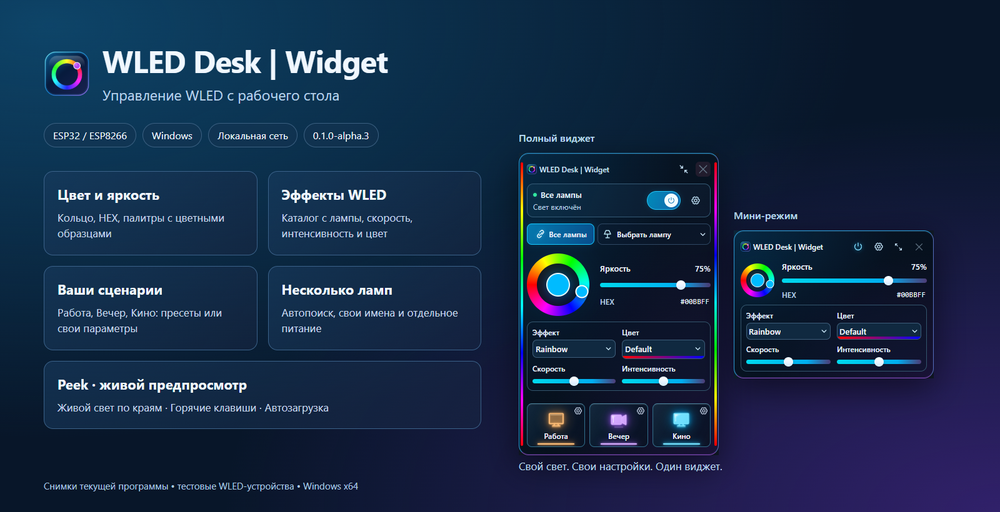
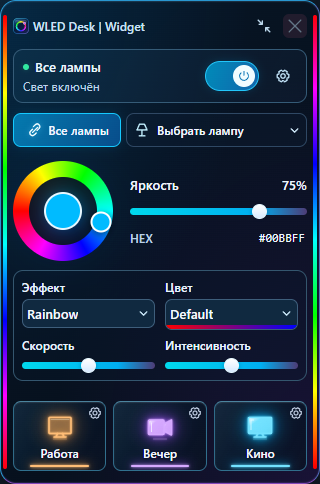
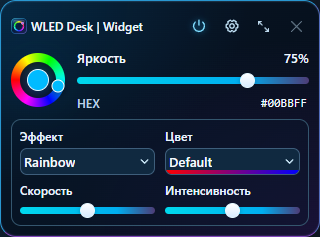
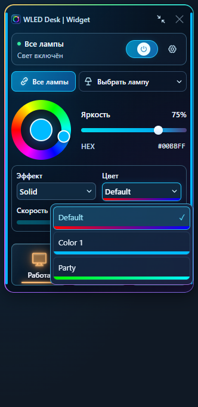
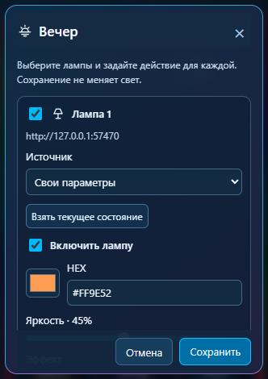

# WLED Desk | Widget

[English](README.en.md) · [Скачать Windows-версию](https://github.com/rebornstudio313/wled-desk-widget/releases) · [Сообщить об ошибке](https://github.com/rebornstudio313/wled-desk-widget/issues)



**Компактное приложение Windows для WLED на ESP32 и ESP8266.** Управляйте светом с рабочего стола: цвет, яркость, эффекты, палитры с предпросмотром и ваши сценарии. Лампы работают в локальной сети, без облачного аккаунта.

**0.1.0-alpha.3 — экспериментальный выпуск Windows x64.** Установщик не подписан цифровой подписью. Это независимый проект, не официальное приложение WLED. [Статус проверок](docs/BUILD-STATUS.md).

## Возможности

| Возможность | Как работает |
|---|---|
| Автопоиск WLED | Обнаружение в домашней сети, добавление найденной лампы кнопкой +; ручной ввод IP/.local сохранён |
| Отдельное управление | Выбор лампы со статусом связи и своим переключателем питания; переименование нажатием на имя в настройках |
| Цвет и палитры | Кольцо, HEX и яркость; реальные названия палитр с цветными полосками предпросмотра |
| Эффекты | Каталог с контроллера, скорость и интенсивность; общие варианты для нескольких ламп |
| Реальное состояние | Изменения с телефона отображаются в виджете через WebSocket, с резервным опросом |
| Сценарии | Работа / Вечер / Кино: свои параметры или сохранённый WLED-пресет отдельно для каждой лампы |
| Синхронизация по нажатию | Один раз скопировать свет выбранной лампы на все или на сохранённый набор; разные наборы для разных источников |
| Peek | Живые цвета LED по краям, прозрачные погасшие участки, тихое восстановление потока |
| Рабочий стол | Полный и мини-режим, трей, поверх окон через ПКМ, перетаскивание за свободные области, сохранение положения |
| Прозрачность | Отдельная компактная панель настройки с живым предпросмотром на виджете |
| Горячие клавиши | Глобальные, настраиваемые, несколько назначений для каждого действия; конфликты отмечаются |
| Автозагрузка Windows | Отключаемый запуск при входе в текущую учётную запись, по желанию сразу в трей |
| Обновления | Версия и уникальный номер сборки; ручная проверка GitHub Releases без автоматической установки |
| Один экземпляр | Повторный запуск показывает уже работающий виджет и восстанавливает его из трея |

<p align="center"></p>

<p align="center"></p>

Скриншоты сняты с текущего интерфейса на изолированных тестовых устройствах. В репозитории нет личных адресов ламп, профиля пользователя и учётных данных.

## Установка

1. Откройте [Releases](https://github.com/rebornstudio313/wled-desk-widget/releases), выберите опубликованный выпуск и скачайте `wled-desk-widget-0.1.0-alpha.3-x64-setup.exe`.
2. Установите приложение для текущего пользователя. При необходимости установщик предложит официальный WebView2.
3. В настройках добавьте найденные WLED или введите их локальный адрес вручную.
4. При желании включите автозагрузку и назначьте свои горячие клавиши.

Если выпуск ещё не опубликован, установщика в публичном списке Releases пока не будет. Бинарные файлы также можно получить сборкой исходников или ручным запуском workflow Windows installer. Не запускайте два разных старых EXE: защита одного экземпляра действует в новых версиях приложения.

## Горячие клавиши по умолчанию

Удерживайте **Ctrl + Alt + Shift**: **W** — показать/скрыть, **P** — питание, **↑/↓** — яркость, **M** — мини/полный режим, **S** — настройки, **1/2/3** — сценарии. В настройках можно удалить их, добавить свои и назначить несколько вариантов на одно действие.

## Ограничения

- Базовое управление редактирует первый сегмент и RGB. Отдельного редактора сегментов, RGBW/CCT и плейлистов нет. Пресеты WLED применяются как сохранены.
- Color 1 и похожие образцы отражают основные цвета лампы; Random Cycle показан условным образцом. Палитра влияет только на эффекты, которые её используют.
- Синхронизация — копирование состояния по нажатию, без постоянной пересылки изменений и без гарантии одинаковой фазы анимаций.
- Peek может быть перехвачен другим клиентом WLED. После ограниченных повторных попыток края остаются прозрачными; отдельное плавающее окно Peek ещё не реализовано.
- mDNS может блокироваться роутером или изоляцией Wi-Fi; ручной ввод адреса остаётся доступным.
- Проверка обновлений обращается к GitHub только по кнопке. Сами лампы управляются локально.
- Полная проверка на чистых Windows 10/11 и разных физических мониторах ещё нужна. Автозагрузка проверена тестом записи/удаления, без перезагрузки компьютера.
- Интеграций с материнскими платами, клавиатурами и сторонними RGB-программами нет.

## Разработка

Нужны Node.js 24, pnpm 11.25.0; для Windows-сборки также Rust MSVC, C++ Build Tools и Windows SDK.

```powershell
pnpm install --frozen-lockfile
pnpm check
pnpm build
pnpm preview
```

Браузерный preview доступен только на `http://127.0.0.1:1421`. Для UI-проверок установите Edge; `pnpm test:ui` запускает текущую регрессионную подборку с тестовыми лампами. `pnpm build:native` создаёт EXE, установщик и метаданные в `release-local`. Нативные проверки: `cargo test --locked --manifest-path apps/desktop/src-tauri/Cargo.toml`. Сквозные проверки Windows — в `tests/integration/*.ps1`.

## Документация

[Установка](docs/INSTALL.md) · [Автопоиск](docs/DISCOVERY.md) · [Палитры](docs/PALETTES.md) · [Сценарии](docs/SCENES.md) · [Peek](docs/PEEK.md) · [Горячие клавиши](docs/hotkeys.md) · [Автозагрузка](docs/AUTOSTART.md) · [Обновления](docs/UPDATES.md) · [Архитектура](docs/ARCHITECTURE.md) · [Оставшиеся работы](docs/REMAINING.md)

## Лицензия

[MIT](LICENSE). [WLED](https://kno.wled.ge/) — отдельный проект со своей лицензией. [Сторонние компоненты](THIRD_PARTY_NOTICES.md). Концептуальные изображения в assets/design — история дизайна; на этой странице используются реальные скриншоты приложения.
