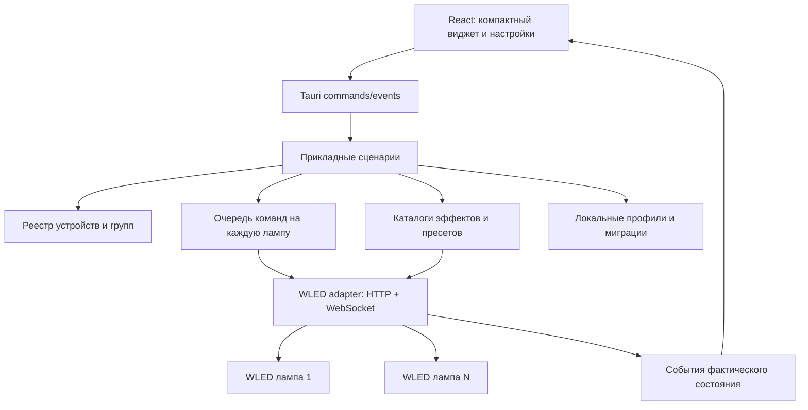

# Архитектура

## Технологии и ответственность

Предложение: Tauri 2, Rust, React, TypeScript, Vite. Первая платформа — Windows.
WebView2 обеспечивает HTML/CSS-интерфейс стеклянного виджета. Эффект стекла
сначала реализовать CSS; нативный blur — необязательное улучшение с fallback.
Выбор библиотек состояния и компонентов зафиксировать при создании первого приложения,
версии закрепить lock-файлами. Сейчас зависимости не установлены.

Сеть и файловая система находятся в нативном слое. Фронтенд не обращается напрямую
к лампам: меньше проблем с CORS, единые таймауты, валидация и отмена запросов.
Разрешения Tauri минимальные; удалённый HTML лампы не исполняется в привилегированном
окне приложения. Родные настройки открываются во внешнем браузере.

## Модули

| Модуль | Ответственность |
|---|---|
| devices | адреса, идентичность, capabilities, онлайн-статус, переподключение |
| groups | выбор целей, смешанное состояние, fan-out и частичные результаты |
| lighting | питание, цвет, яркость, сегменты, переходы |
| effects | каталоги, метаданные, палитры, совместимость групп |
| presets | пресеты устройства, локальные сцены, быстрые слоты, плейлисты |
| settings | параметры приложения, экспорт, импорт, миграции |
| transport | HTTP/WS, deadline, backoff, разбор ошибок, ограничения запросов |
| storage | атомарная запись профиля, резервная предыдущая версия, миграции |
| shell | окно, трей, DPI, мониторы, автозапуск по выбору |
| diagnostics | локальные журналы с редактированием адресов/секретов при экспорте |

## Состояние и команды

- Отделять desired от reported. Показать pending, не рисовать подтверждённый успех
  до ответа лампы; после ошибки перечитать фактическое состояние.
- Один сериализованный поток записи на устройство. Ползунки coalesce по ключу
  поля, окончательное значение имеет приоритет. Начальные debounce/лимиты измерить
  на ESP8266, а не заявлять как универсальные.
- Групповые операции ограниченно параллельны, возвращают результат для каждой лампы.
- Повторять автоматически только безопасные чтения и идемпотентные установки.
  Не повторять вслепую создание/удаление пресета и toggle-команды.
- WS для обновлений состояния, при разрыве — polling с backoff; при скрытом окне
  уменьшать фоновую активность. Не открывать новый WS на каждый контрол.
- Кеши каталогов отдельны от профиля. При смене прошивки инвалидировать их.

## Данные

Профиль: schemaVersion, устройства, группы, локальные сцены, быстрые слоты, UI.
Device UUID не меняется при редактировании адреса. Сведения capabilities и фактическое
состояние обновляются с устройства, не становятся единственным источником истины.
Сцены содержат назначения на конкретные устройства; конфликты разрешаются при импорте.

Репозиторий на рабочем столе хранит исходники и документацию. После установки
приложение хранит пользовательские данные в системном каталоге app-data Tauri;
конкретный identifier/path закрепить на этапе shell. Пользователь может экспортировать
профиль в выбранное место. Реальные бэкапы для разработки — только в .local/ (Git ignore).
Обновление приложения не перезаписывает пользовательский профиль.

## Безопасность и ограничения

- Локальный инструмент, без облака, аккаунта, telemetry и сервера, слушающего внешний интерфейс.
- Адрес пользователя нормализуется; разрешены http/https, запрещены file/javascript,
  credentials в URL и произвольные пути API. localhost/link-local обрабатывать явно,
  публичные адреса не сканировать; нестандартный LAN/VPN — ручной режим.
- Не обходить ошибки TLS. Не отправлять конфигурационные пароли в логи.
- Не требуются администратор, USB-драйверы или доступ к клавиатуре/материнской плате.
- Приложение не обнаруживает и не управляет другими RGB-программами.
- Если WLED сообщает realtime/live, отображать статус внешнего потока и ссылку на
  собственные настройки WLED. Не пытаться остановить или перенастроить его источник.

## Реализация по слоям

Сначала simulator + доменные правила, затем desktop shell и транспорт, затем UI.
Железо используется для коротких осмысленных проверок после тестов адаптера.
Изменения Wi-Fi/GPIO не нужны для разработки базового управления.
