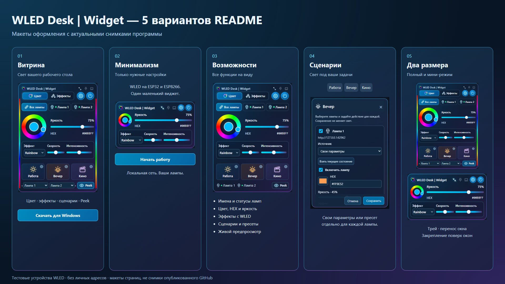

# Пять вариантов оформления GitHub

Все пять макетов используют снимки текущей программы: без деморежима, с именами
и состояниями ламп, новой иконкой мини-режима и обновлёнными элементами управления.
Это варианты оформления README, а не снимки пяти опубликованных страниц GitHub.
В изображениях используются изолированные тестовые устройства, без личных IP-адресов.

[01 Витрина](readme-options/01.md) · [02 Минимализм](readme-options/02.md) ·
[03 Функции](readme-options/03.md) · [04 Сценарии](readme-options/04.md) ·
[05 Мини-режим](readme-options/05.md).

Главная картинка: [github-hero.png](media/github-hero.png).
Снимки воспроизводятся scripts/capture-release-media.mjs; баннер —
scripts/render-github-media.mjs; пять макетов — scripts/render-readme-variants.mjs.
Ранние рисунки в assets/design сохранены как архив истории дизайна.
