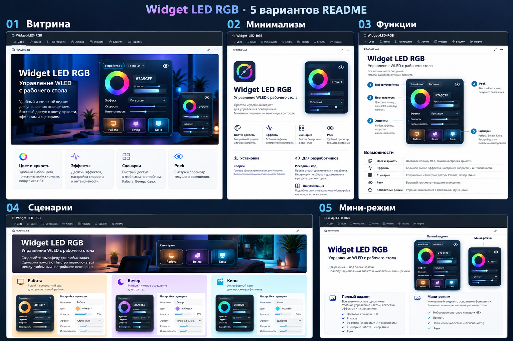

# Концепты GitHub README

Концепт-лист создан imagegen до окончательного выбора имени. Поэтому на нём
сохранено раннее название Widget LED RGB и иллюстративные формы интерфейса.
Финальное имя — **WLED Desk | Widget**. Рабочая главная картинка и README используют
точные снимки текущего приложения. Концепты — направления дизайна, не доказательство
наличия функций и не реальные страницы опубликованного репозитория.

[01 Витрина](readme-options/01.md) · [02 Минимализм](readme-options/02.md) ·
[03 Функции](readme-options/03.md) · [04 Сценарии](readme-options/04.md) ·
[05 Мини-режим](readme-options/05.md).

Финальный баннер: [github-hero.png](media/github-hero.png). Воспроизводимый рендер
из фактических снимков: scripts/render-github-media.mjs от корня проекта.
