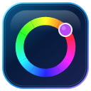
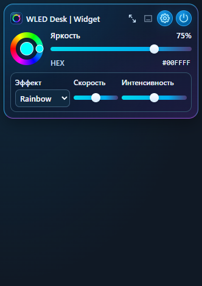

<p align="center"></p>

# WLED Desk | Widget

**Небольшой контроллер WLED для Windows.** Подключите ESP32/ESP8266 по локальной
сети и управляйте светом, эффектами и сценариями с рабочего стола.



## Быстрый запуск

```powershell
pnpm install --frozen-lockfile
pnpm build
pnpm preview
```

Добавьте локальный адрес лампы в настройках. Сохранённые устройства подключатся
автоматически. Для готового установщика проверьте [статус сборки](../BUILD-STATUS.md).

Цвет · яркость · эффекты · пресеты · сцены · Peek.

[Установка](../INSTALL.md) · [Сценарии](../SCENES.md) · [Сборка Windows](../BUILD-WINDOWS.md).
