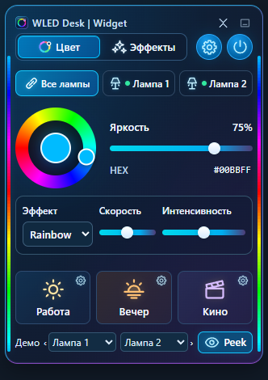

# WLED Desk | Widget

Управление WLED с рабочего стола: обзор возможностей и текущих границ.

| Область | Реализовано | Ограничение |
|---|---|---|
| Устройства | Ручное добавление и автоматическое подключение | Локальный адрес, без поиска всей сети |
| Цвет | Кольцо, HEX, яркость | RGB |
| Эффекты | Каталог с ламп, скорость, интенсивность | Палитры ещё в плане |
| Сценарии | Персональные назначения пресетов/параметров | Свои параметры первого сегмента |
| Peek | Две полосы, раздельные источники | WLED отдаёт поток одному клиенту |
| Окно | Полный и компактный режим | Трей требует нативной проверки |

## Проверяемость

Unit и браузерные сценарии хранятся в репозитории. [Результат сборки](../BUILD-STATUS.md)
показывает фактическую готовность EXE. Отдельные статусы предпочтительнее обещания стабильности.

[Установка](../INSTALL.md) · [Разработка](../BUILD-WINDOWS.md) · [Лицензия](../../LICENSE).
