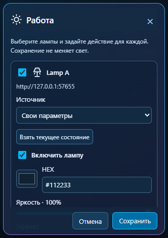

# WLED Desk | Widget

## Ваши три сценария света

**Работа** — удобные для вас яркость и цвет. **Вечер** — спокойный свет.
**Кино** — освещение по вашему вкусу. Названия кнопок не задают жёсткие цвета:
каждый сценарий настраиваете вы.

1. Откройте шестерёнку карточки.
2. Выберите участвующие лампы.
3. Каждой назначьте сохранённый пресет или свои параметры.
4. Сохраните; нажмите карточку для применения.

Можно смешивать назначения: первой лампе — свой цвет, второй — её пресет №7.
Сохранение не меняет свет. Выход из редактора без сохранения не перезаписывает сценарий.

Прочие возможности: цветовое кольцо, HEX, эффекты, несколько устройств, Peek и мини-режим.

[Подробнее о сценах](../SCENES.md) · [Установка](../INSTALL.md) · [Сборка](../BUILD-STATUS.md).
