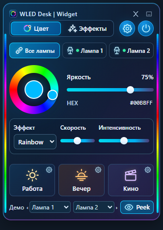
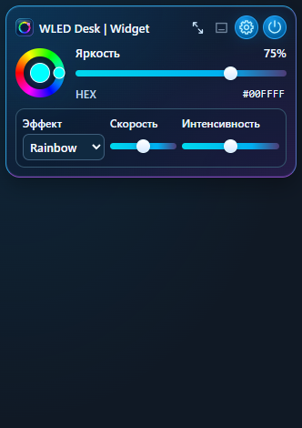

# WLED Desk | Widget

## Столько управления, сколько нужно сейчас

| Полный виджет | Мини-режим |
|---|---|
| Выбор ламп, цветовое кольцо, эффекты и сцены | Маленькое кольцо, HEX, яркость и параметры эффекта |
| Живой Peek по краям | Peek приостанавливается, чтобы не держать лишний поток |
| Подробные действия | Основные настройки и кнопка раскрытия |

Настройки режима запоминаются. Цвет и эффекты продолжают управляться в мини-режиме.
Для скрытия всего окна предусмотрен нативный трей — его готовность указана в
[статусе сборки](../BUILD-STATUS.md), браузерный preview не имитирует эту возможность.

[Окно и трей](../WINDOW-MODES.md) · [Установка](../INSTALL.md) · [Разработка](../BUILD-WINDOWS.md).
